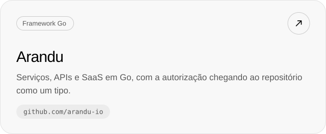
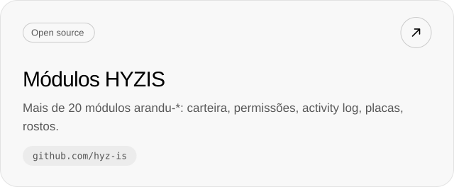
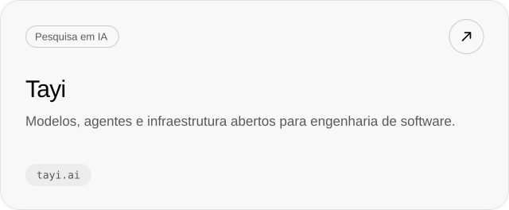
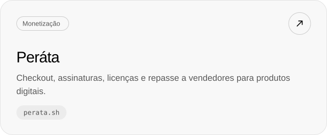
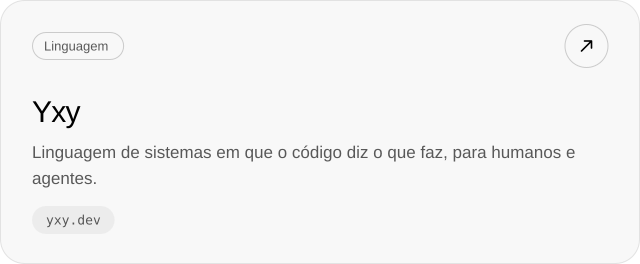
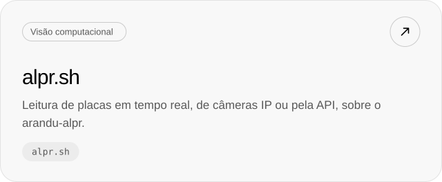

<a href="https://github.com/arandu-io">
  <picture>
    <source media="(prefers-color-scheme: dark)" srcset="assets/hero-dark.svg" />
    
  </picture>
</a>

Escrevo software há 22 anos. Hoje quase tudo que faço é em Go, sobre o [Arandu](https://github.com/arandu-io), um framework em que a autorização chega até o repositório como um tipo, então um handler que não passou por uma policy não compila. Na [HYZIS](https://github.com/hyz-is) publicamos os módulos abertos que as aplicações Arandu usam, e por cima deles construímos os nossos produtos.

### Construindo agora

<a href="https://github.com/arandu-io"><picture><source media="(prefers-color-scheme: dark)" srcset="assets/card-arandu-dark.svg" /></picture></a>
<a href="https://github.com/hyz-is"><picture><source media="(prefers-color-scheme: dark)" srcset="assets/card-modules-dark.svg" /></picture></a>
<a href="https://tayi.ai"><picture><source media="(prefers-color-scheme: dark)" srcset="assets/card-tayi-dark.svg" /></picture></a>
<a href="https://perata.sh"><picture><source media="(prefers-color-scheme: dark)" srcset="assets/card-perata-dark.svg" /></picture></a>
<a href="https://yxy.dev"><picture><source media="(prefers-color-scheme: dark)" srcset="assets/card-yxy-dark.svg" /></picture></a>
<a href="https://alpr.sh"><picture><source media="(prefers-color-scheme: dark)" srcset="assets/card-alpr-dark.svg" /></picture></a>

### Stack

<picture>
  <source media="(prefers-color-scheme: dark)" srcset="assets/stack-dark.svg" />
  
</picture>

### Ferramentas abertas

- [ufw-cloudflare](https://github.com/paulorlima9/ufw-cloudflare): mantém as faixas de IP da Cloudflare liberadas no UFW, com atualização diária por systemd.
- [copyfail-fix](https://github.com/paulorlima9/copyfail-fix): mitigação e patch da CVE-2026-31431 (Copy Fail) em VPS Ubuntu e Debian.

### Contribuições

<picture>
  <source media="(prefers-color-scheme: dark)" srcset="https://raw.githubusercontent.com/paulorlima9/paulorlima9/output/contributions-dark.svg" />
  
</picture>

[hyz.is](https://hyz.is) · [arandu.io](https://arandu.io) · [x.com/paulorlima09](https://x.com/paulorlima09)
